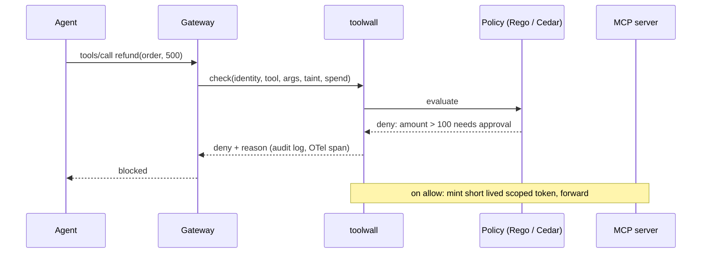

# toolwall

Policy firewall for agent tool calls. Decides whether *this agent* may call *this tool* with *these arguments* right now, before the call reaches the MCP server.

## Why

Guardrail libraries inspect text. Gateways route traffic. Nobody answers the authorisation question for tool calls: who is the agent, on whose behalf, which tool, which arguments, how much budget is left, and did untrusted content shape the request. OWASP Top 10 for Agentic Applications (2025) puts tool misuse and privilege abuse at the top; the MCP roadmap lists enterprise auth as open work.

toolwall does not replace a gateway. It plugs into one as a policy decision point, the way admission controllers plug into Kubernetes.

## How it works

## Status

Early. See [BACKLOG.md](BACKLOG.md).
