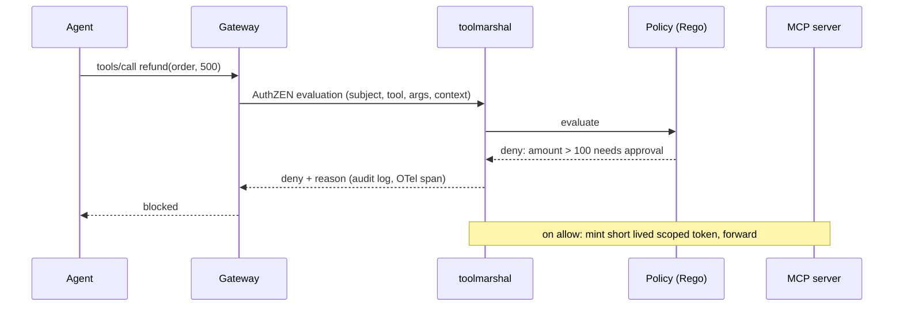

# toolmarshal

A policy firewall for agent tool calls, in early development. The aim is to decide whether *this agent* may call *this tool* with *these arguments* right now, before the call reaches the MCP server.

Today it logs tool calls and has the first decision engine. It does not block anything yet. See [What works today](#what-works-today).

## Why

Guardrail libraries mostly inspect text, and gateways mostly route traffic. toolmarshal focuses on the authorisation question for tool calls: who is the agent, on whose behalf, which tool, which arguments, how much budget is left, and did untrusted content shape the request. The [OWASP Top 10 for Agentic Applications](https://genai.owasp.org/2025/12/09/owasp-top-10-for-agentic-applications-the-benchmark-for-agentic-security-in-the-age-of-autonomous-ai/) (December 2025) lists tool misuse (ASI02) and identity and privilege abuse (ASI03) among its ten risks. The [MCP roadmap](https://modelcontextprotocol.io/development/roadmap) names agent identity and enterprise ready security as a priority area.

toolmarshal is not meant to replace a gateway. The plan is to plug into one as a policy decision point that speaks the OpenID AuthZEN API, the way admission controllers plug into Kubernetes (backlog items 03c and 12).

## Position

Other open source tools already ship coding agent hooks, budgets and approval flows, so budgets, approvals and dry run stay minimal here and come last. The planned focus is an OPA based decision point with a standard AuthZEN endpoint, delegated identity (acting on behalf of a user), token exchange, taint tracking and a tested Rego policy pack.

## Target architecture

This is where the project is heading. The [backlog](BACKLOG.md) says which parts exist.

## What works today

- A stdio proxy and an HTTP proxy that sit in front of an MCP server and log every `tools/call`. They pass all traffic through unchanged.
- A decision function with a static allowlist, and one backed by OPA. The OPA version sends the agent, tool and arguments to an OPA server and denies on any error or odd reply. The first Rego policy is a per agent tool allowlist (see `policy/`).
- The proxies do not call the decision point yet, so nothing is blocked. That is item 03b in the backlog.
- Not built yet: argument rules, agent identity, token exchange, spend budgets, taint tracking, human approval, OpenTelemetry audit and gateway integration.

## Status

Early development, not ready for production use. Progress is tracked in [BACKLOG.md](BACKLOG.md).
