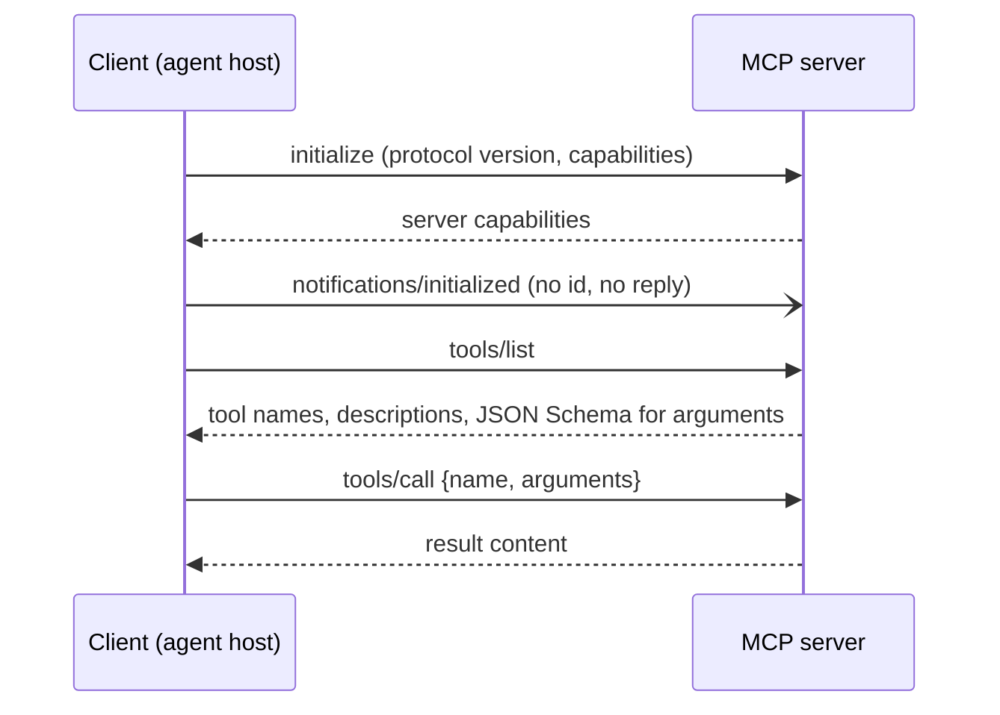
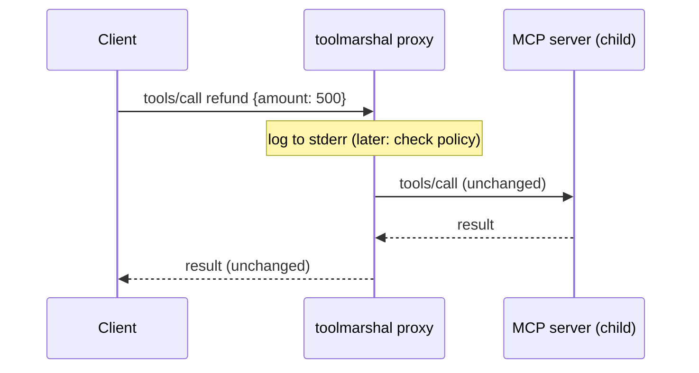
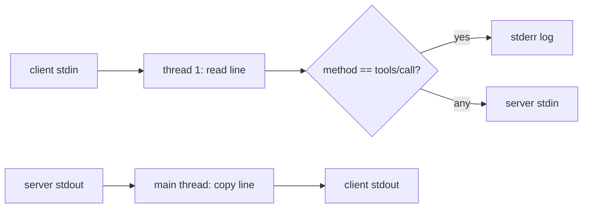

# 01 MCP message flow

## Session over stdio

MCP is JSON-RPC 2.0. Over stdio the client starts the server as a child process, and each message is one line of JSON on stdin or stdout.

`tools/list` is what the model sees. `tools/call` is where something happens in the outside world.

## Where toolmarshal sits

## Inside the proxy

## Why this design

- Transparent pipe: copies lines both ways and only peeks at client lines. Works with any MCP server, nothing to configure.
- One hook, `log_if_tool_call`. It becomes the enforcement point once it can block instead of only log.
- Logs go to stderr because stdout is the protocol channel.
- Reading by line is safe because the stdio transport forbids newlines inside a message.
- One thread per direction. With a single thread, the proxy could block reading server output while the server waits for the next request, and neither would move.

## Check yourself

**Why must a stdio MCP server never print debug output to stdout?**
The client reads stdout as protocol. A stray print is an invalid JSON-RPC message and breaks the session.

**Enforce policy at `tools/list` or `tools/call`?**
Both, for different reasons. Filtering `tools/list` hides tools the agent should never see and keeps the prompt smaller. The model can still send a call for a tool it guessed or was told about, so `tools/call` is the real enforcement point.

**Why does `notifications/initialized` get no reply?**
It has no `id`. In JSON-RPC a message without an `id` is a notification, and the receiver must not answer it.
