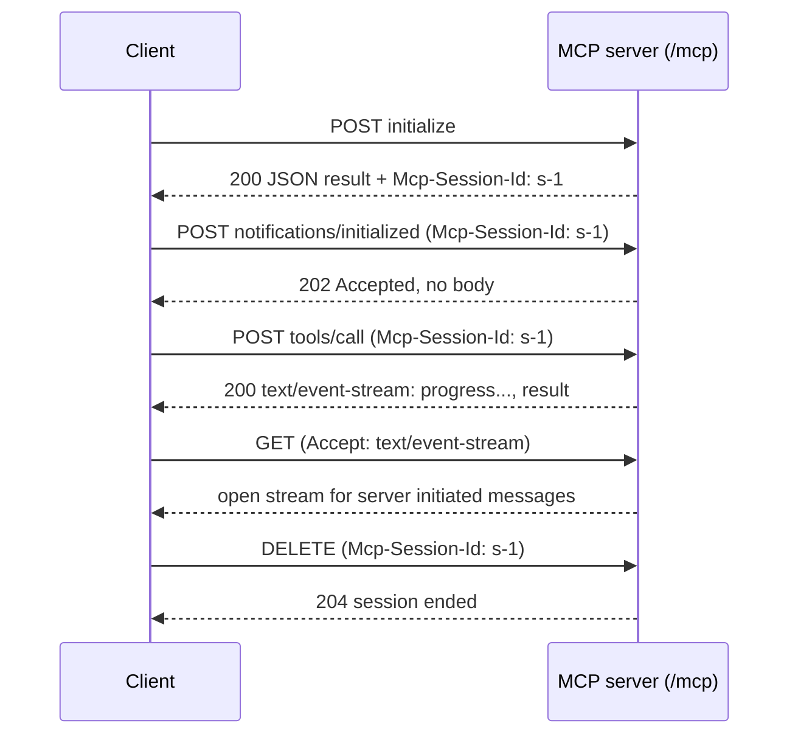
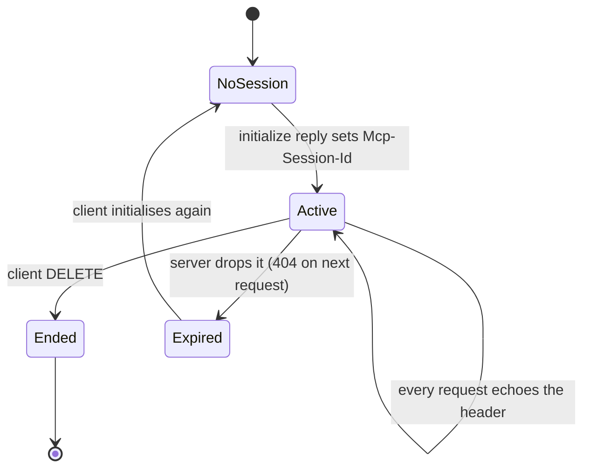
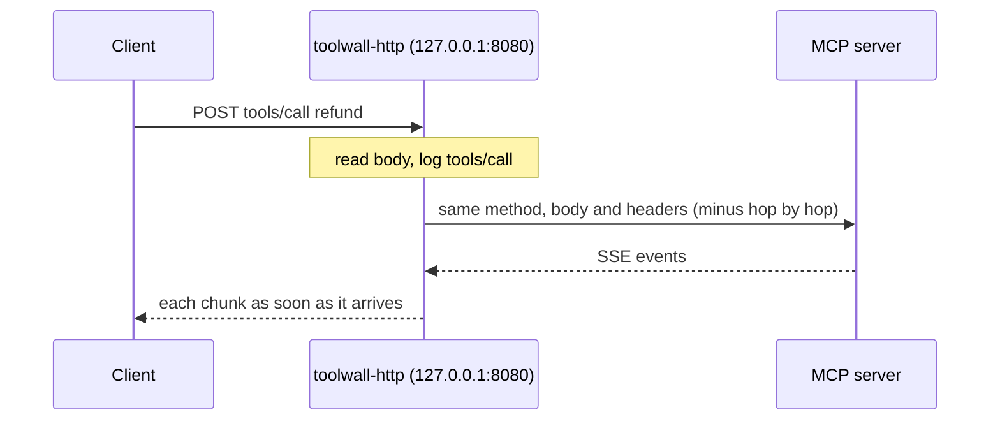
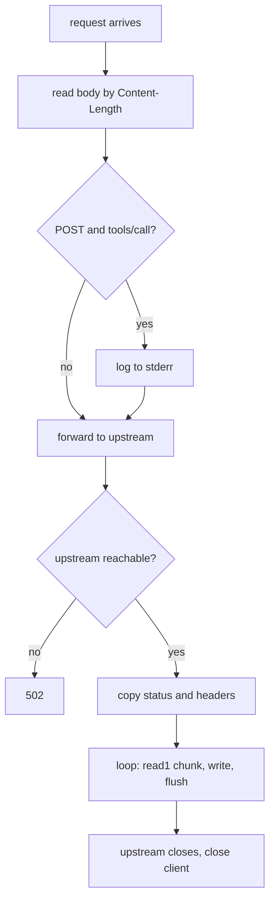

# 01b MCP over Streamable HTTP

## One endpoint, three verbs

Over HTTP there is no child process. The server publishes one URL, say `/mcp`, and the client talks to it with plain HTTP.

The client sends `Accept: application/json, text/event-stream` on every `POST`. The server picks: a single JSON reply, or an SSE stream when it wants to send progress or its own requests before the result.

## How the session lives

The session ID is the only session state the client carries. It sits in a header, not in the JSON, so a proxy that passes headers keeps sessions working without understanding them.

## Where toolwall sits

## Inside one request

## Why this design

- Byte level pass through. toolwall reads client requests and never rebuilds replies, so MCP features it does not know about keep working.
- `read1` instead of `read`: `read(65536)` waits for a full buffer, which would hold back SSE events. `read1` returns whatever has arrived.
- HTTP/1.0 to the client means the stream ends when the connection closes. No chunked encoding to write, at the cost of no keep alive.
- Hop by hop headers (`Connection`, `Transfer-Encoding`, ...) describe one hop, so they are dropped. `Content-Length` is dropped too, since the reply ends when the connection closes.
- Bound to 127.0.0.1. A local MCP server reachable on all interfaces is open to DNS rebinding from any web page the user visits.
- Stateless. The session ID passes through, so several proxies can front one server.

## Check yourself

**Why is the session ID a header and not a JSON field?**
Load balancers and proxies route on headers without parsing bodies. Sticky routing to the right server instance needs only the header.

**A tool runs for two minutes and sends progress. Why does the reply come as SSE and not JSON?**
JSON is one response at the end. SSE lets the server push progress notifications, and even ask the client something (sampling, elicitation), before the final result on the same request.

**What breaks if the proxy buffers the whole upstream response before sending it?**
Progress arrives all at once at the end, and the long running GET stream never delivers anything because it never ends.

**The client gets 404 with a session ID it used a minute ago. What should it do?**
The server dropped the session. Start again with a fresh `initialize` without the header.
