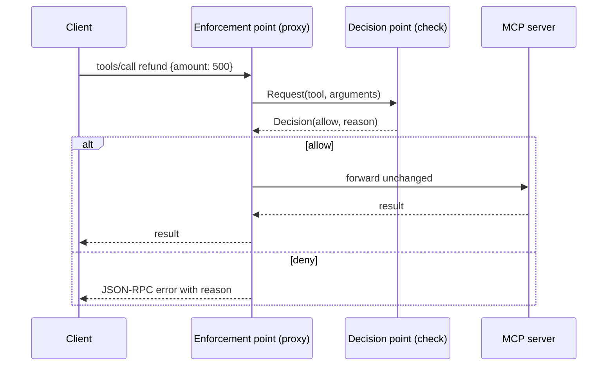
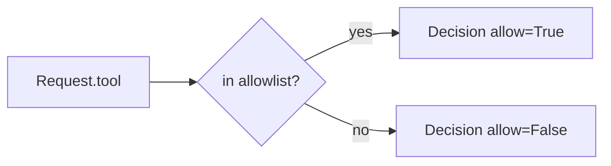
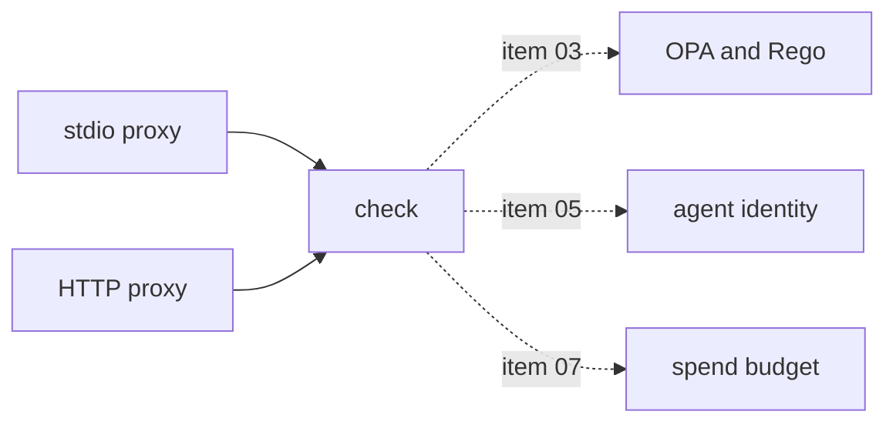

# 02 Decision API

## Two jobs, two places

The proxy enforces. `check` decides. This is the PEP and PDP split from XACML, NIST ABAC and OPA.

## Inside check

No branch returns allow by default. An empty allowlist denies everything.

## Where this goes next

## Why this design

- Pure function: no sockets, threads or processes in tests, so every rule is a one-line assertion.
- Policy lives in one place. Two transports share it, and a third would too.
- Default deny: a typo in the allowlist fails closed, a missing rule fails closed.
- Reason on every decision: audit logs and error messages come from the same source, and a denial can be explained.
- Frozen dataclasses: a decision cannot be altered between the check and the enforcement.
- Exact string match on tool names: no prefix or case folding, so `read_file_all` is not `read_file`.

## Check yourself

**Why keep the decision point out of the proxy?**
The proxy handles transport, framing and threads. Policy changes for different reasons and at a different speed. Separate, it can move to OPA or a remote service without touching the proxies.

**Why default deny?**
Failure should reduce access, not grant it. With default allow, a bug or an unknown tool silently passes.

**Is an allowlist on tool names enough to be safe?**
No. An allowed tool can still be called with harmful arguments, for example a refund of any size. That is why items 03 and 04 add argument rules.

**What does the enforcement point still need to do that `check` does not?**
Turn a deny into a protocol-correct answer (a JSON-RPC error with the request id), log it, and never forward the call.
