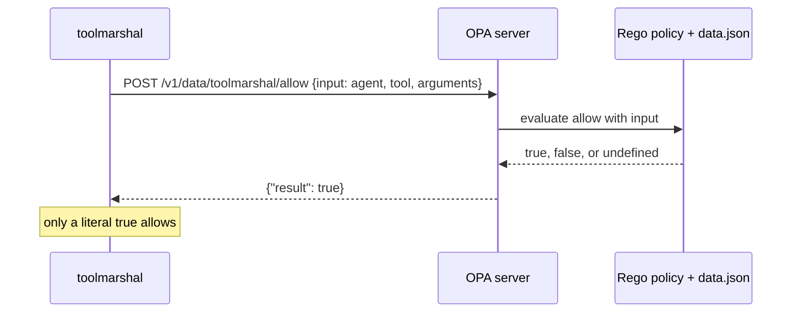
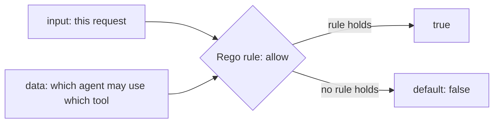
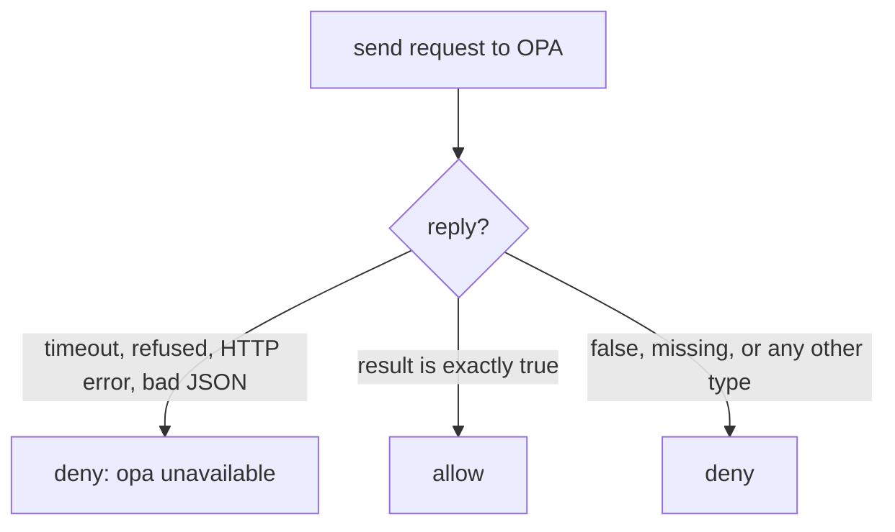

# 03 OPA and Rego basics

## What OPA does

OPA answers one question: is this allowed? The application sends facts. OPA applies rules and data and sends back a decision.



## The three inputs to a decision



## The policy, line by line

```rego
package toolmarshal

import rego.v1

default allow := false

allow if input.tool in data.agents[input.agent]
```

- `package toolmarshal` puts the rule at `/v1/data/toolmarshal/allow`.
- `default allow := false` is the fail closed line. When no rule holds, the answer is `false`.
- `data.agents[input.agent]` looks up the list for this agent. An agent that is not in the data has no list, so the expression is undefined and the rule does not hold.
- `input.tool in ...` is true when the tool is in that list.

## What each case returns

| Agent | Tool | Result |
|---|---|---|
| support-bot | read_file | true |
| support-bot | refund | false (not in the list) |
| unknown-bot | read_file | false (no list for this agent) |
| anonymous | anything | false (empty list) |

## Failing closed in toolmarshal



## Why this design

- Rules and data change without a code release. Adding a tool for an agent is one line in `data.json`.
- The Python side is small and generic. It forwards facts and reads a boolean, so later rules (argument limits, identity, budgets) are Rego changes.
- Default deny appears twice, once in Rego and once in the Python client, so a broken policy or a broken server both end in a denial.
- Only a literal `true` allows. A reply such as `"yes"` or `1` is treated as a bug, not as permission.
- OPA runs as a server so the policy stays loaded in memory. A subprocess per call would pay start up cost on every tool call.

## Check yourself

**Why does an agent missing from `data.json` get denied, and not an error?**
The lookup is undefined for that agent, so the `allow` rule does not hold. Undefined is not an error in Rego. The `default` then returns `false`.

**What happens to tool calls when the OPA server is down?**
All of them are denied, with the reason "opa unavailable". That is deliberate. Allowing on failure would let anyone switch off the policy by stopping the server.

**Why is `result == true` checked strictly in Python?**
Truthy checks accept strings and numbers. A policy change that returns an object or a string by mistake would then start allowing calls.

**Why is the allowlist in `data.json` and not inside the rule?**
Rules and data change at different speeds and for different reasons. Rules change rarely and need review. The list of who may use what changes often.
