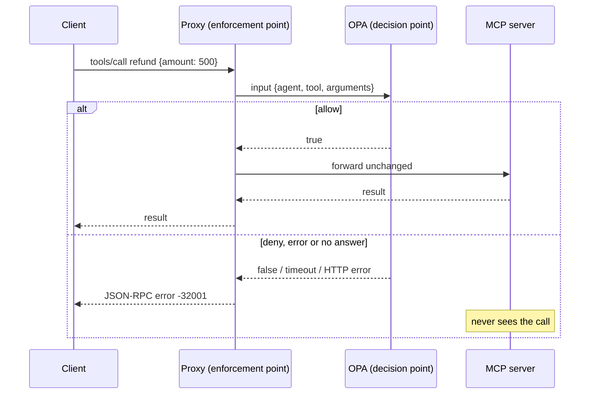
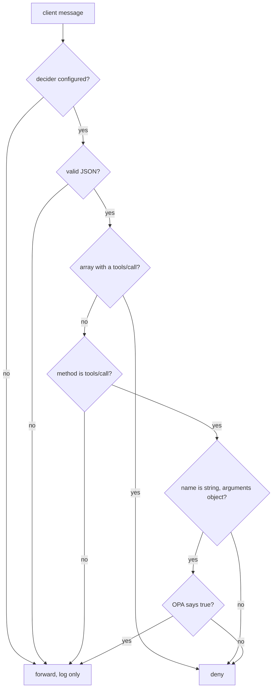
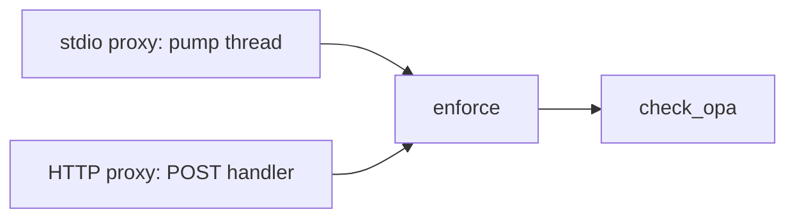

# 03b Enforcement point and failing closed

## The path of a tool call

## What `enforce` does with one message

Non-JSON and non-call traffic is forwarded: the MCP server rejects it itself, and only `tools/call` carries an action to authorise.

## Two transports, one function

On stdio, two threads write to the same stdout: one copies server output, the other writes deny errors. `LockedWriter` makes each message a single locked write so two messages never interleave.

## Why this design

- Failing closed: the question is "what happens when the policy cannot answer". For a security control the answer is deny. An outage then stops agents instead of silently removing the guard.
- Malformed and batched calls are denied because a check that only understands well formed input can be skipped by sending something odd.
- The client gets a generic error. The reason stays in the log, so the policy shape is not leaked.
- Opt-in through `TOOLMARSHAL_OPA_URL` is a compromise: log-only still works, but forgetting the variable means no protection. See ADR 0005.

## Check yourself

1. OPA is stopped and a client calls an allowed tool. What does the client see, and why?
   *A JSON-RPC error. Any failure to get a literal `true` is a deny.*
2. Why does the HTTP proxy answer with status 200 and an error body, not 403?
   *The JSON-RPC error belongs to the MCP layer. MCP clients expect a JSON-RPC response to a POST, and transport errors are for transport faults.*
3. What would break if both stdio threads wrote to stdout without a lock?
   *A deny line could land in the middle of a server reply, producing invalid JSON for the client.*
4. Why is a `tools/call` inside a JSON array denied?
   *Without that rule it would skip `enforce`, which only inspects single objects.*
5. What does a missing `TOOLMARSHAL_OPA_URL` mean, and why is that a weakness?
   *Log only, no blocking. Misconfiguration looks like normal operation.*
